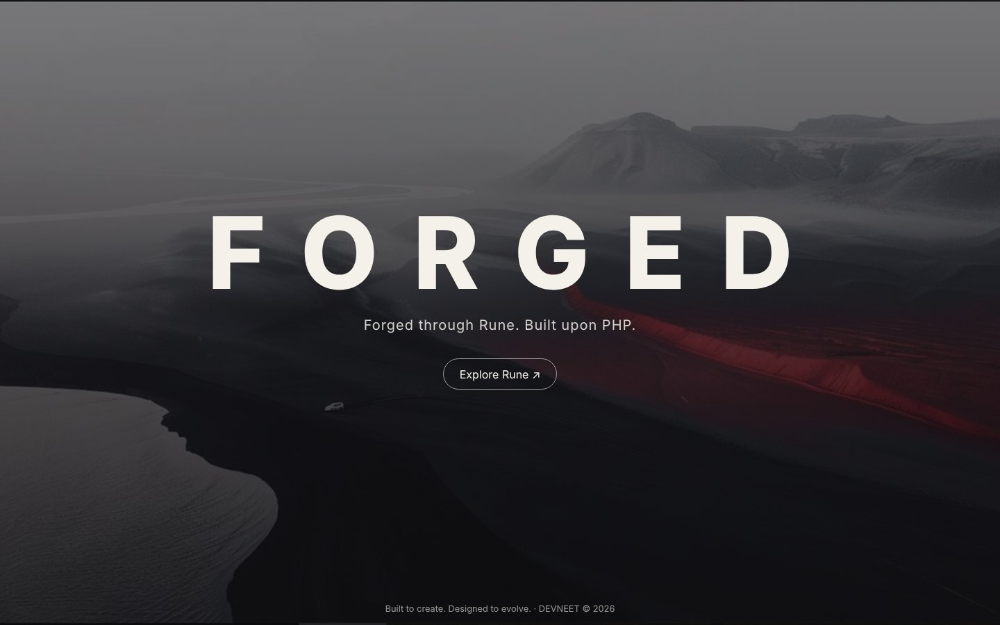

# Relic Web

**Forged through Rune. Built upon PHP.**

A small runite that builds a website without a framework. Write the page in many small files, and Rune bundles them into one: `dist/index.php`.



**[Explore Rune ↗](https://github.com/devneet-id/rune)**
**[Explore Reliquary ↗](https://github.com/devneet-id/reliquary)**

---

## The Relic

This repo is a **relic**: a runite sealed as a `.rune`, listed in the **[Reliquary](https://github.com/devneet-id/reliquary)**.

| Relic | `.rune` | Carries |
| ----- | ------- | ------- |
| `devneet-id/relic-web/cast` | `cast.rune` | the runite `cast`, with `src/`, `dist/assets/`, `.gitignore` and this README as shards |

### Get it

**From the void** — a new folder, Rune and one awakening file:

```bash
composer require devneet/rune
```

```php
#!/usr/bin/env php
<?php
require_once __DIR__ . '/vendor/autoload.php';

Rune\Ethereal::awakening();
```

Save it as `cast`, then:

```bash
php cast
```

Answer `y`, and choose `devneet-id/relic-web/cast`.

**Into a runite you already have:**

```bash
php cast reliquary --relic-runite=devneet-id/relic-web/cast
```

**Or clone this repo:**

```bash
git clone https://github.com/devneet-id/relic-web.git
cd relic-web
composer install
php cast start
```

---

## Made with Rune

This app is a **runite**: one file named `cast`, engraved from the origin runes of **[Rune](https://github.com/devneet-id/rune)**, a lore-driven, modular concept beneath PHP.

| Rune | Role in this app |
| ---- | ---------------- |
| Aether | opens and closes the flow |
| Chanter | registers the casts |
| Whisper | speaks to the user |
| Weaver | fills the templates while bundling |
| Crafter | bundles `src/` into `dist/index.php` |
| Forger | scans the vessel, copies the website into `ready/` |
| Cipher | gives every bundle its hash |
| Keeper | remembers the shards in `.echoes` |
| Specter | serves and watches beside the flow |

Want to engrave your own? Start from the **[Rune repository](https://github.com/devneet-id/rune)**.

### Requirements

* PHP 8.1+
* Composer
* Rune 1.20+ *(for the reliquary)*

---

## The Website

```
src/
├── index.head.html   goes into <head>
├── index.html        goes into <body>
├── index.css         becomes <style>
├── index.js          becomes <script>
├── index.php         runs on top, before the page
└── vessel/           every library lives here
    └── README.md
dist/
├── index.php         the bundle (php cast build)
└── assets/
    ├── background.jpg
    └── snapshot.jpg
```

* Edit only `src/`. `dist/index.php` is made by `php cast build`.
* Put images and fonts in `dist/assets/`. The page reads them as `assets/...`.
* **The vessel** is `src/vessel/`, the home of every library. `php cast build` takes it per folder: drop `name.css`, `name.js`, `name.php` or `name.html` there, side by side, and they join the bundle, no need to list them in `cast`. Images and folders inside stay out.
* **The background** is `dist/assets/background.jpg`. Drop your own image there, no rebuild needed. Without it, the page falls back to a dark gradient.

---

## Registered Casts

| Cast | Description |
| ---- | ----------- |
| `build` | Bundle `src/` into `dist/index.php`. |
| `serve` | Serve `dist/` on `127.0.0.1:8000`. |
| `watch` | Rebuild when `src/` changes. |
| `start` | Build, then serve and watch. |
| `store` | Keep the assets as shards. |
| `ready` | Make `ready/` for production. |

---

## Try it

Run every command inside this folder.

**The main screen** — every cast with its echo:

```bash
php cast
```

**Build** — many files become one:

```bash
php cast build
```

**Develop** — `serve` and `watch` run until **Ctrl+C**:

```bash
php cast serve                            # http://127.0.0.1:8000
php cast watch                            # rebuild on every change in src/
php cast start                            # build, then serve & watch in their own windows
```

**Ship** — a folder you can upload to any PHP host:

```bash
php cast ready                            # build + store, then copy into ready/
```

**Share** — the runite and its shards as one relic:

```bash
php cast store
php cast reliquary --runite-relic         # cast -> cast.rune
```

**Built-in casts of Rune** — every runite carries them:

```bash
php cast grimoire --rune=Crafter          # look inside the builder
php cast grimoire --arcane                # every step of the last run
php cast reliquary --shards               # the files that travel with the relic
```

---

## What you learn

| Cast | Lesson |
| ---- | ------ |
| `build` | Crafter: item, seed, shard, spark · Forger: scan the vessel per folder |
| `serve`, `watch`, `start` | Specter: a dev server, an observer, casts beside the flow |
| `store` | Keeper: shards travel with the relic |
| `ready` | Forger: copy files and folders |

**A website is many files, Rune makes it one.**

---

## References

* [Rune](https://github.com/devneet-id/rune) — Application foundation and tooling.
* [Rune Lore](https://github.com/devneet-id/rune-lore) — The full documentation, from the void to the beyond.
* [Reliquary](https://github.com/devneet-id/reliquary) — The relics of Rune.

---

**Built to create. Designed to evolve.**

**DEVNEET ©**
